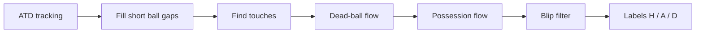
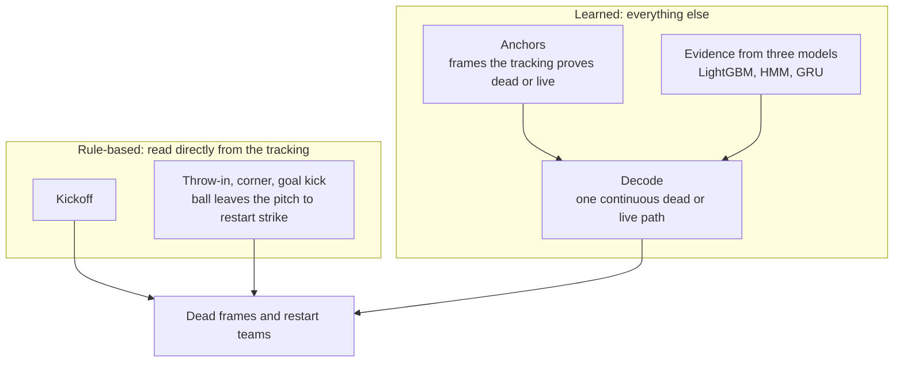
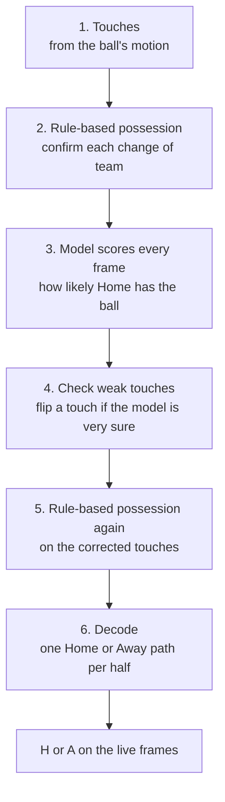

# Technical Document: Possession and Dead-Ball Labelling from Tracking Data

*Terms written like [this](GLOSSARY.md) are explained in the [glossary](GLOSSARY.md).*

## Abstract

We label every one of the 199,319 frames of a football match as Home possession, Away possession, or dead ball. The
input is the tracking data ([ATD](GLOSSARY.md#atd): the ball and the 22 players) and, for set pieces only, the type of
event named in the [Smart Tagging](GLOSSARY.md#smart-tagging) file. We use no external data.

The method has two connected flows, one for dead ball and one for possession, and each flow has a rule-based part and a
learned part. The rule-based parts work directly on the tracking: a touch is a break in the ball's motion, possession
changes only when an opponent's touch is confirmed as controlled, and a set piece starts when the ball crosses a line
and ends when a still ball is struck at the right spot. The learned parts handle what the rules cannot see: stoppages
with no ball exit (fouls, offsides, injuries) and touches that are weak or contested. They use small models
([LightGBM](GLOSSARY.md#lightgbm), a two-state [HMM](GLOSSARY.md#hmm) and a small [GRU](GLOSSARY.md#gru)) that read how
the players move over seconds. They are trained only on [labels the tracking itself proves](GLOSSARY.md#clean-labels),
and then again on their own confident frames ([self-training](GLOSSARY.md#self-training)). A
[decode](GLOSSARY.md#decode) keeps stoppages in one piece and keeps the number of possessions in line with the touches,
and a [blip filter](GLOSSARY.md#blip-filter) removes tiny live stretches between dead spells.

On the public 5-minute window the final system reaches spell F1 0.750, macro F1 0.917, team accuracy 0.968 and dead-ball
F1 0.870, up from 0.606, 0.871, 0.888 and 0.868 for the touch rules with the learned stoppage detector alone. The main
limitations are short flicker on contested balls, training on a single match, and no model of events such as
celebrations or video-review breaks. Training on several matches and adding more triggers are the next steps.

## Contents

1. [Introduction and data](#1-introduction-and-data)
2. [Approach](#2-approach)
3. [Training](#3-training)
4. [Possession rules](#4-possession-rules)
5. [Results](#5-results)
6. [Limitations](#6-limitations)
7. [Future work](#7-future-work)
8. [Reproduction](#8-reproduction)
9. [References](#9-references)

## 1. Introduction and data

**Task.** One label per frame: **H** or **A** (the team with the ball), **D** (dead ball) or **X** (not graded). See
[H, A, D, X](GLOSSARY.md#h-a-d-x).

**What we use.** The data bundle is described in [DATA.md](DATA.md).
- **Tracking ([ATD](GLOSSARY.md#atd)).** The ball and player positions and speeds for the whole match
  ([DATA.md](DATA.md#automatic-tracking-data-atd)). Every rule and every model is built from it, and it is the only
  source of training labels, which are made by algorithms from the tracking (section 3).
- **[Smart Tagging](GLOSSARY.md#smart-tagging).** Used only to say which set piece happened
  ([DATA.md](DATA.md#smart-tagging)). Its times and its team field are never read. Every boundary comes from the
  tracking.

**What we do not use.** No external data of any kind: no other matches, no outside tracking sets, no outside labels and
no pretrained models. The broadcast recording, the video and the homography file are not used by the pipeline. Freely
available tracking data of other matches exists, but we did not use it.

### 1.1 Why learn at all

The rules are exact when they can see. The problem is that the tracking often cannot see the ball: it is missing on
about 43% of frames. A foul or an offside may also leave no ball signal at all. So rules alone cannot label the whole
match.

What is left is that **the players move in recognisable ways around what the ball is doing.** In a stoppage all 22
slow down together and stand, then speed up at the restart. In possession, the team with the ball stretches and pushes
forward while the other team compacts and drops back. These patterns can be written as numbers (collective speed,
sprints, players standing, spread, how long the players have been still) and a model can learn them. Player movement is
tracked on every frame, so the learned parts use it to fill the frames where the ball is lost and to correct touches the
rules are unsure about.

The ball matters differently in the two flows:
- **Dead ball: player movement was enough.** We also tried a model that estimates where the ball is from the players
  alone, and gave it to the dead-ball detector as extra input. It did not help, so the dead-ball models use player
  movement only. The ball is used by the rules and to make the training labels.
- **Possession: the ball is essential.** Who has the ball is decided by who touched it, so the touch rules are the
  primary source, and the labels the possession models learn from are built from clear touches. The models learn what
  possession looks like in player movement from those ball-based labels, and use it to correct weak touches and fill the
  frames between touches. They do not take a ball column as input.

In short: **player movement carries the live/dead signal and the ball carries the possession signal.**

## 2. Approach

### 2.1 Overview

Two flows work together: the **dead-ball flow** (which frames are dead, and who restarts) and the **possession flow**
(on live frames, which team has the ball). Each has a **rule-based part**, trusted first because it is exact where the
tracking is clear, and a **learned part**, added where the rules cannot decide. The learned parts never replace the
rules: they correct a weak rule or fill frames the rules leave open. Each learned part has a [guard](GLOSSARY.md#guard)
and falls back to the rule-based logic if its checks fail.

The possession flow runs second because it needs the dead frames and the restart teams from the dead-ball flow.

### 2.2 Preparing the tracking: ball gaps and touches

Both flows start from the same two steps (`gap_fill.py`, `touch_detector.py`).

1. **Fill short ball gaps.** Short gaps are filled with a straight line, never across half-time. Long gaps stay missing,
   because a straight line is not a safe guess for a ball that has vanished for seconds.
2. **Find the touches.** A [touch](GLOSSARY.md#touch) is a moment where the ball's own motion breaks. Between touches the
   ball moves in a nearly straight line and slows smoothly, so a sudden change of direction or speed marks a touch. The
   [toucher](GLOSSARY.md#toucher-and-credited-touch) is the nearest player to the ball, if close enough. This gives a
   short list of touches, and everything after reasons about touches, not about every frame.

The ideas behind the touch detection and the stoppage triggers are in the references ([1], [2], [3]).

### 2.3 Dead-ball flow

Inside a set-piece stretch the rule-based result always wins. The learned part fills the rest.

**Rule-based part** (`dead_ball.py`, `restart_triggers.py`, `kickoff_detector.py`)

- **Not in play.** Frames outside the halves are dead by the match clock.
- **Kickoff.** Dead from the whistle (where the players start slowing together) until the strike on the centre spot.
- **Throw-in, corner, goal kick.** It starts at the [exit trigger](GLOSSARY.md#exit-trigger), which a Smart Tag of that
  type must confirm so that tracking noise is rejected. It ends at the [restart strike](GLOSSARY.md#restart-strike), where
  a still ball at the right spot is struck and really leaves. A ball tossed to the taker or a dummy run does not count.
  With no strike seen, the [calm run](GLOSSARY.md#calm-run) that covers the exit ends it.
- **Restart team.** The player at the ball at the strike, otherwise the team that did not touch the ball last before
  the exit.
- **Early restart.** If the learned path stays dead well after a restart the rules chose, the players had not resumed,
  so the segment is extended and the restart moves with it.
- **Fallback.** If the learned detector is unavailable or fails its guard, a calm-run rule finds the other stoppages.
  Its speed and duration limits are learned for the match from where calm runs end at kickoffs and set-piece strikes.

**Learned part** (`dead_ball_ml.py`, `dead_ball_features.py`, `seq_net.py`)

It handles every dead stretch that is not a kickoff or a set piece: fouls, free kicks, offsides, penalties, injuries.
They have no ball exit, so the rules cannot see them, but every stoppage has the players slowing and standing
together.

1. **[Anchors](GLOSSARY.md#anchors).** Frames the ball track and touches prove. Dead: a confirmed exit, the wait up to
   the restart strike, the moments before a kickoff, a ball resting outside the penalty areas. Live: a few seconds of a
   ball clearly being passed around.
2. **Player features.** From player positions and speeds only: team shape, speeds, sprints, players standing,
   pressing, crowding, braking, averaged over short and long [windows](GLOSSARY.md#window-features) into the past and
   the future.
3. **Evidence.** Three models score every frame that is not an anchor, and their [log-odds](GLOSSARY.md#log-odds) are
   averaged.
   - **[LightGBM](GLOSSARY.md#lightgbm)**, trained on the anchors.
   - **[HMM](GLOSSARY.md#hmm)**, unsupervised, with a "stopped" and a "moving" state. It uses no labels.
   - **[GRU](GLOSSARY.md#gru)**, trained on the anchors, reading long windows of the same features.
4. **[Decode](GLOSSARY.md#decode).** One best dead/live path per half. Every change of state has a cost, so a stoppage
   stays in one piece. Very short dead spells are dropped and very short live gaps are closed.
5. **Restart team.** The last credited touch near the end of the stretch, if there is one.
6. **[Guard](GLOSSARY.md#guard).** The detector checks itself against this match's own anchors: enough anchors, each
   model separating dead from live well enough, and a plausible share of dead frames. If a check fails, the calm-run
   fallback is used.

### 2.4 Possession flow

**Rule-based part** (`touch_detector.py`, `control.py`, `assemble.py`; details in section 4)

Possession is one pointer ("which team has it") that moves only when an opponent's touch is confirmed as controlled.
A stray touch, a duel or a deflection leaves it where it was. After a stoppage the restart team sets the pointer, and
dead frames are always D.

**Learned part** (`possession_ml.py`, `seq_net.py`)

The rules stay primary. The model only corrects weak touches and fills the doubt.

1. **[Clean labels](GLOSSARY.md#clean-labels).** A frame gets a team only when the tracking makes it clear: near a
   [clear touch](GLOSSARY.md#clear-touch-and-weak-touch), or between two clear touches of the same team. Contested
   touches, the flight between touches of opposite teams and dead frames stay unlabelled.
2. **Model.** A [LightGBM](GLOSSARY.md#lightgbm) and a [GRU](GLOSSARY.md#gru) each give the probability that Home has the
   ball on every frame, and their log-odds are averaged. They read team-shape features only (where each team stands and
   moves, and how that differs between the teams, over past, future and centred windows). No ball column is an input.
3. **[Touch fix](GLOSSARY.md#touch-fix).** A weak touch is flipped to the other team when the model is very sure of
   that team around the touch. Step 2 then runs again on the corrected touches.
4. **[Decode](GLOSSARY.md#decode).** The corrected rule labels vote for their team, the model adds its own evidence,
   and one best Home/Away path per half pays a cost for each change. The cost is chosen so that the path makes about as
   many changes as the touches confirm, which keeps the number of possessions realistic and stops the label flickering
   with the model. Very short possessions take the previous team.
5. **[Guard](GLOSSARY.md#guard).** The model is used only if enough frames have clean labels and it separates them well.
   Otherwise the rule-based possession is kept.

### 2.5 Blip filter (final step)

A short live stretch between two dead spells becomes dead, unless play is visible inside it (several touches, or the
ball travelling a real distance). It fills 12 such blips in this match.

### 2.6 Why this design

- **Rules first, models where rules are blind.** Touches, exits and strikes are exact when the tracking sees them. Fouls
  and offsides leave no ball signal, and a touch is sometimes ambiguous. Those are the two places a model helps.
- **Algorithm-made labels only.** The models learn from frames the tracking proves, so they need no outside data.
- **A decode instead of frame-by-frame calls.** A stoppage stays one block, and possession changes only about as often as
  the touches confirm.
- **Fallbacks.** If a model is missing or a guard fails, the rules run, so the output never depends on a model that
  looks wrong.

## 3. Training

Every label the models train on is made by an algorithm from the tracking of this match. No person labelled a frame. A
model's score is always measured against these algorithm-made labels, never against a reference.

### 3.1 Windows, not single frames

A single frame says very little. A stoppage shows up as the players slowing together over seconds, and possession shows
up in how both teams move around a touch. So every model reads a [window](GLOSSARY.md#window-features): the same player
numbers averaged over short and long spans before and after a frame. The [GRU](GLOSSARY.md#gru) reads a long window as a
sequence, so it sees the whole context. The models read player movement, not the ball (section 1.1).

### 3.2 Clean labels

We label only the frames the tracking proves and leave the rest unlabelled.
- **Dead ball:** the [anchors](GLOSSARY.md#anchors), a small share of frames that are surely dead and a larger share that
  are surely live.
- **Possession:** the [clean labels](GLOSSARY.md#clean-labels), about a fifth of the live frames.

Training on fewer but reliable labels, and letting the models extend to the rest, keeps the labels from teaching the
models the rules' own mistakes.

### 3.3 Self-training

After the first round the whole flow (decode included) runs with the round-1 models. Frames where the result is confident
and agrees with the rules join the training set, and the models are trained again
([self-training](GLOSSARY.md#self-training)). This lets them learn the contested stretches next to the proven ones, with
no label that did not come from the tracking.

### 3.4 Avoiding leakage

Neighbouring frames are almost identical, so a random split would let a model see the frame next to its test frame. We cut
the match into 2-minute blocks, hold some out at a time, and leave a gap around them
([cross-fitting](GLOSSARY.md#cross-fitting-and-out-of-fold-scores)). Every frame of the training match is scored by a
model that never saw its block, and the pipeline uses these scores for this match. A final model fitted on all blocks is
stored for any other match.

### 3.5 Features and hyperparameters

- **Small, regularised models, fixed in advance.** We chose small models up front and did not search large grids:
  shallow trees with a low learning rate and subsampling for the LightGBMs, and a GRU with a few thousand weights, dropout,
  weight decay and early stopping, averaged over three seeds.
- **Features by meaning, not by search.** The feature groups follow what a stoppage or a possession change looks like in
  player movement: everyone slowing, a team compact and pushing, sprints.
- **Choices used only algorithm-made labels.** They were judged by out-of-fold [ROC AUC](GLOSSARY.md#roc-auc) on the clean
  labels, never against reference data.
- **Fixed seeds.** Training again gives the same models.

### 3.6 What worked and what did not

Worked, roughly in the order we found them:
1. A learned stoppage detector next to the calm-run rule.
2. A touch fix with a learned model, with the touch rules kept primary.
3. Clean labels for possession, which removed the noise that made an earlier model produce too many possessions.
4. A decode whose cost per change is set from the touches.
5. Self-training and a GRU in both parts, the largest single gain.
6. A blip filter after the main flow.

Tried and not adopted:
- Using the touches as the only input to the decode, and snapping the decode to touch times.
- Refining the exact start of a possession change.
- Smaller models to reduce overfitting.
- A prior on how long a possession lasts.
- A joint decode of dead, Home and Away in one path.
- A ball-position estimator learned from player movement, as extra input for the dead-ball detector (section 1.1).
- A 1D CNN as a second sequence model next to the GRU. It gave no clear gain.
- A restart confirmation in the final step. It extended nothing and was removed.

## 4. Possession rules

These rules decide who has the ball (`touch_detector.py`, `control.py`, `assemble.py`). Their settings come from the
literature in section 9 and from experiments on the tracking, not from guesses.

### 4.1 Touches

A touch is a break in the ball's own motion: the ball moves in a nearly straight line and slows smoothly until something
changes its direction or speed. We compare the motion just before and just after each frame, and close candidates merge
into one. The ball must be trustworthy around the touch (seen, or filled over a short gap). The
[toucher](GLOSSARY.md#toucher-and-credited-touch) is the nearest player, but only if close enough. Otherwise the event
has no team and never changes possession.

### 4.2 Loose balls and challenges

An opponent's touch changes possession only if it is confirmed as control
([chain, carry, deflection](GLOSSARY.md#chain-carry-deflection)):
- **Chain.** Soon after, the same player touches the ball again, or the ball goes to a teammate. A teammate who is only
  nearby does not confirm it.
- **Carry.** No other touch follows and the same player stays with the ball. A player standing under a ball in the air
  does not count, because the ball travels much farther than he does.
- **Deflection.** If the original team touches the ball again before the opponent does anything with it, nothing changes.
- **Duels and 50/50 balls.** With no chain and no carry, the touch is a stray, a duel or a kick, and possession stays.
  The next touch can take the ball.
- **Where the change starts.** At the opponent's own touch, not at the later frame when the evidence became clear.

### 4.3 Restarts, dead frames and kickoff

- After a stoppage the [restart team](GLOSSARY.md#restart-team) comes from the dead-ball flow and overrides what the touch
  rules would say, because a restart has a clear possessor. With nobody near the ball at a throw-in, corner or goal kick,
  the team that did not touch it last takes it, as the laws say.
- When the restart team is unknown, possession is cleared and the first touch afterwards opens it.
- Dead frames are always D. Frames before the first kickoff have no evidence and stay X.
- A kickoff is taken by the player nearest the centre spot, and that team has the ball from the kick.

### 4.4 Learned correction

The learned part (section 2.4) corrects weak touches the model strongly contradicts, runs these rules again, and decodes
the frames in between. The rules above stay the primary source.

## 5. Results

We report only the public 5-minute window, the one reference we use. The numbers are for reporting. No model, threshold or
constant was chosen from them. The scores are defined in [EVALUATION.md](EVALUATION.md).

| Stage | Spell F1 | Macro F1 | Team accuracy | Dead-ball F1 | Possessions (reference 17) |
|---|---|---|---|---|---|
| Touch rules with the learned stoppage detector | 0.606 | 0.871 | 0.888 | 0.868 | 16 |
| + touch fix and learned possession (LightGBM) | 0.640 | 0.893 | 0.930 | 0.868 | 13 |
| + self-training and a GRU in both parts | 0.750 | 0.917 | 0.968 | 0.870 | 15 |
| + blip filter (final) | 0.750 | 0.917 | 0.968 | 0.870 | 15 |

- The learned possession part mainly lifts team accuracy and macro F1.
- Self-training with the GRU gives the largest step in spell F1.
- The 5-minute window has no short live blips, so the blip filter leaves it unchanged.
- Retraining from scratch with the pinned requirements gives the same models and the same submission file (section 8).

## 6. Limitations

- **Flicker on contested balls.** When the ball is loose or two teams are close, the label can flip for a short time. The
  blip filter and the merge of very short possessions remove some of it, but short flicker inside a live stretch, and dead
  spells that start or end a little early or late, remain.
- **Noisy ball tracking.** The ball is unseen on about 43% of frames. Long gaps leave the touch rules blind, and the
  learned part has to fill them from the players alone.
- **One match for training.** All models are trained on this match, with out-of-fold scores to avoid leakage. They have
  seen one team's style and one tracking setup. Without outside tracking data we could not train more broadly.
- **Weak touches.** A touch by a player far from the ball, or with an opponent close, is uncertain. The model corrects it
  only when very sure, so some wrong touches pass through.
- **Restart team.** For stoppages with no clear last touch the restart team is unknown, and the first touch decides it,
  which can be wrong for a few seconds.
- **Events that are not modelled.** Celebrations, video-review breaks, injuries without a clear slowdown and substitutions
  are handled only through the player-movement signals.

## 7. Future work

- **Train on several matches,** including freely available outside tracking data, for more variety in style, tracking
  quality and stoppage types.
- **More triggers** for events now left to the learned detector: goal celebrations, video-review breaks, substitutions,
  injuries and cooling breaks, penalties and their set-up.
- **A learned touch scorer** in place of the fixed touch rule, trained on the clear touches.
- **A model that also reads the ball,** such as a sequence model on the ball path and the nearest players, as a third
  independent view.
- **A joint decode** that carries the restart team through a stoppage, instead of handing it over between the two flows.
- **Per-situation settings** for the touch fix and the cost per change, chosen by cross-validation on algorithm-made
  labels.

## 8. Reproduction

See [REPRODUCTION.md](REPRODUCTION.md).

1. Install `requirements-solution.txt`.
2. Put the data bundle in `data/` so that `data/tactical/` exists, or set `MTAH_DATA_DIR` to the folder that contains
   `tactical/` (see [DATA.md](DATA.md)).
3. Run `python solution/run_pipeline.py --out TikiTech.csv`, then `python evaluation/validate_submission.py TikiTech.csv`.

To rebuild the models from scratch, install `requirements-train.txt` and run `solution/train_dead_ball_ml.py` and then
`solution/train_possession_ml.py`. The seeds are fixed, and retraining reproduced the stored models and a byte-identical
submission file. The training scripts overwrite `solution/models/` and clear the evidence caches in `solution/cache/`.

## 9. References

[1] Comonitski, J. *Generating footballing event data from match tracking data.* Medium.
https://medium.com/@johncomonitski/generating-footballing-event-data-from-match-tracking-data-1730c58ad598

[2] arXiv:2202.00804. https://arxiv.org/pdf/2202.00804

[3] Montoliu, R., Martín-Félez, R., Torres-Sospedra, J. and Martínez-Usó, A. Team activity recognition in association
football using a bag-of-words-based method. *Human Movement Science*, 41:165–178, 2015.
