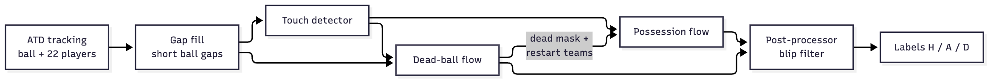
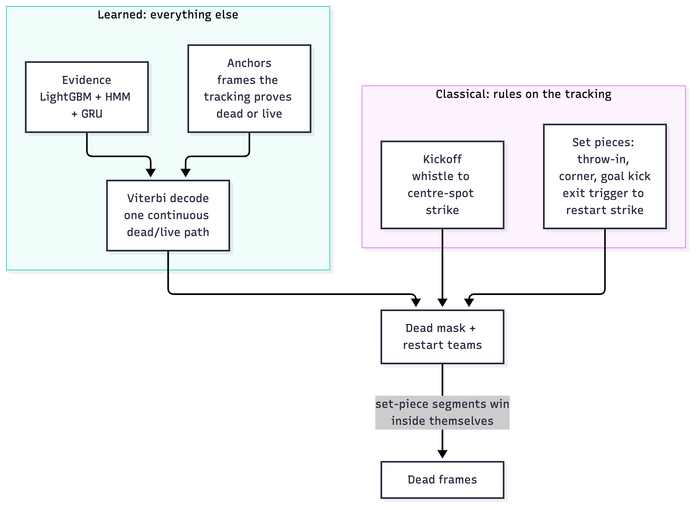
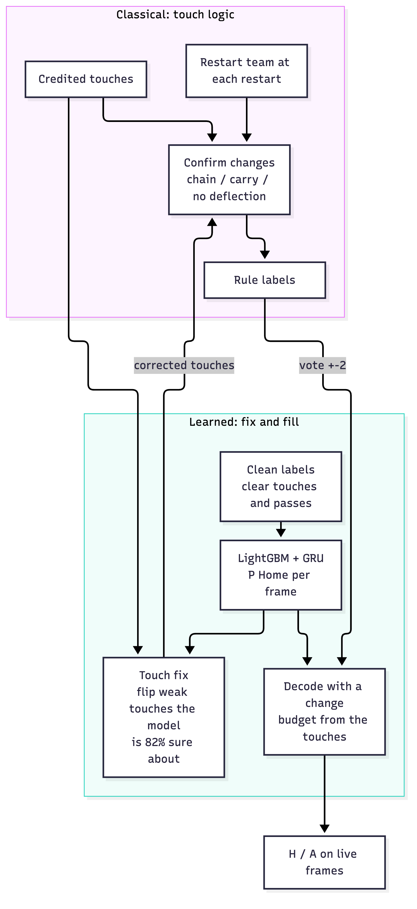

# Possession and dead-ball labelling from tracking data

Technical document.

## Abstract

We label every frame of a football match (25 fps, about 200,000 frames) as Home possession, Away
possession, or dead ball, using only the tracking data (the ATD: ball and 22 player positions and speeds)
and the type of each set piece named in the Smart Tagging file. We use no external data. The method has two
connected flows, one for dead ball and one for possession, and each flow has a classical part and a
learned part. The classical parts are rules on the tracking: a touch is a break in the ball's motion, a
possession changes only when an opponent's touch is confirmed as controlled, and a set piece starts when the
ball crosses a line and ends when a still ball is struck at the right spot. The learned parts handle what the
rules cannot see: stoppages with no ball exit (fouls, offsides, injuries) and touches that are weak or
contested. They use small models (LightGBM, a 2-state HMM and a small GRU) on sequences of player-movement
features, trained only on labels that the tracking itself proves ("clean labels"), then trained again on their
own confident frames (self-training). A decode that pays a cost for every change keeps stoppages continuous and
keeps the number of possessions in line with the touches. A short post-processor removes live blips between
dead spells. On the public 5-minute window the final system reaches spell F1 0.750, macro F1 0.917, team
accuracy 0.968 and dead-ball F1 0.870, up from 0.606, 0.871, 0.888 and 0.868 for the touch logic alone. The
main limitations are residual flicker on contested balls, training on a single match, and no model of events
such as celebrations or video-review breaks. Training on several matches and adding more triggers are the
most direct next steps.

## 1. Introduction and assets

**Task.** One label per frame: H or A (the team in possession), D (dead ball), or X (not graded).

**Data used.**
- *Tactical ATD* (tracking, FIFA/EPTS format): ball and player positions and speeds for the whole match.
  Every rule and every model is built from this. It is also the only source of training labels, and those
  are made by algorithms from the tracking itself (section 3).
- *Smart Tagging*: used only as a label that says which set piece happened (throw-in, corner, goal kick,
  kickoff). Its start and end times and its team field are never read. Every boundary comes from the tracking.
- *Tactical video*: watched by the team to understand what possession, loose balls and restarts look like, which
  shaped the rules. No label was taken from it and no model reads it.

**Not used.** No external data of any kind: no other matches, no outside tracking sets, no outside
labels, no pretrained models. Freely available tracking data of other matches exists, but we did not use it,
and we report the system without it. The broadcast recording and the homography file are not used by the
pipeline.

### 1.1 Why learn at all: the intuition

The rules in this solution are exact when they can see. A touch is a break in the ball's motion, an exit is the
ball over a line, a restart is a still ball struck at the right spot. The problem is that the tracking often
cannot see the ball: it is missing on about 43% of frames (occlusion, a pass in the air, a crowded box). A
foul or an offside may also leave no ball signal at all. So the rules alone cannot label the whole match.

Watching the match shows what is left: **the players move in recognisable ways around what the ball is doing.**
- In a stoppage, all 22 slow to a walk together, stand, and then all speed up at the restart. In live play
  somebody is always running.
- In possession, the team with the ball stretches and pushes forward while the other team compacts and drops
  back, and the shape and drift of both teams change when possession changes.

These patterns can be written down as features (collective speed, sprints, players standing, spread, pressing,
crowding, how long the players have been still, and the same numbers over seconds of past and future) and a
model can learn them. The learned parts therefore use the **players' movement**, which is tracked on every frame,
to fill the frames where the ball is lost and to correct touches the rules are unsure about.

**Where the ball still matters.** The two flows use it differently, and we found the difference to be
important:
- **Dead ball: the players' movement was enough.** We also tried a model that estimates where the ball is
  from the players' movement alone (it halves the error of the obvious guess, the centre of the players), and
  gave its output to the dead-ball detector as extra features. It did not improve the detector, so the final
  dead-ball models use player movement only. The ball is used by the rules (exits, strikes, resting ball) and to
  make the anchor labels.
- **Possession: the ball is essential.** Who has the ball is decided by who touched it, so the touch logic is
  the primary source, and the clean labels the possession models learn from are built from clear touches. The
  models learn what possession looks like in player movement from those ball-based labels, and then use it to
  fix weak touches and to fill the frames between them. Remove the ball and the possession flow loses its
  anchor. The final possession models do not take the ball as an input column.

In short: **player movement carries the live/dead signal, and the ball carries the possession signal.** The
design is a rule backbone from the ball, with learned player-movement models filling and correcting it.

## 2. Approach

### 2.1 The idea in one page

The task is one label per frame (25 fps, 199,319 frames): **H** or **A** (the team in possession),
**D** (dead ball), or **X** (not graded). We solve it in two connected flows.

- **Dead-ball flow:** which frames are dead, and which team restarts play.
- **Possession flow:** on the live frames, which team has the ball.

Each flow has a **classical part** and a **learned part**.

- The classical part uses rules on the tracking. It is exact where the tracking is clear, and it is what
  we trust first.
- The learned part is added where the rules cannot decide. It reads how the players move and fills or
  corrects the doubt.

The learned parts never replace the rules. They correct a rule where the rule is weak, or they fill the
frames the rules leave open. Each learned part checks itself against the algorithm's own anchors and falls
back to the classical rule when a check fails.

What goes in: the ATD (ball and player positions and speeds), and the Smart Tagging file. Smart Tags are used
only as a label that says "a throw-in / corner / goal kick / kickoff happened around here". Their start
and end times and their team field are never used. Every boundary comes from the tracking.

### 2.2 Shared base (classical)

1. **Parse.** The ATD is turned into arrays in metres (pitch 105.3 x 68 m). Half 2 is turned 180 degrees where
   a model needs both teams to attack the same end.
2. **Gap fill** (`gap_fill.py`). The ball is missing on about 43% of frames. Gaps shorter than 1 s are
   filled in a straight line, never across the half break. Longer gaps stay missing.
3. **Touch detector** (`touch_detector.py`). A touch is a break in the ball's own motion. At each frame we
   compare the incoming and outgoing heading and speed over 0.16 s either side. A big change is a
   candidate; candidates closer than 0.2 s merge. The toucher is the nearest player, only within 3.5 m,
   otherwise the touch has no team. This gives a short list of touches (a few hundred credited ones) and
   everything after reasons about touches, not frames.

### 2.3 Dead-ball flow

**Classical part** (`dead_ball.py`, `restart_triggers.py`, `kickoff_detector.py`)

- **Not in play.** Frames outside the halves, and the second half before its kickoff, are dead by the match
  clock.
- **Kickoff.** Dead from the start of the calm run (all players slow together) that ends at the strike on
  the centre spot. The nearest player at the ball takes it.
- **Set pieces where the ball leaves the pitch** (throw-in, corner, goal kick).
  - *Start:* the exit trigger. The ball is more than 0.5 m over a line for at least 3 observed frames. The
    side line means a throw-in, the goal line means a corner or a goal kick. A Smart Tag of that type must
    confirm it, which is how an exit that is only tracking noise is rejected.
  - *End:* the restart trigger. The ball sits still at the spot the laws require (side line, corner arc, goal
    area), is struck, travels at least 5 m and stays on the pitch. A ball tossed to the taker or a dummy
    run fails this check and the search moves on. With no strike seen, the calm run that covers the exit
    ends it, at its last touch in the final seconds.
  - *Restart team:* the player at the ball at the strike, otherwise the team that did not touch the ball last
    before the exit.
- **Early restart.** If the learned path stays dead for 5 s or more right after the restart a set-piece rule
  chose, the players had not resumed. The segment is extended to the end of that stretch and the restart
  marker moves with it.
- **Fallback rule (calm run).** If the learned detector is unavailable or fails its checks, a rule finds the
  other stoppages instead. The median player speed stays under a threshold for a minimum time (both numbers
  are learned per match from where calm runs end at the kickoff and set-piece strikes), dead starts where
  the players began slowing, and ends at the last touch in the final 5 s of the run.

**Learned part** (`dead_ball_ml.py`, `dead_ball_features.py`, `seq_net.py`)

It handles every dead stretch that is not a kickoff or a set-piece segment: fouls, free kicks, offsides,
penalties, injuries. These have no ball exit, so the rules cannot see them. What every stoppage does have
is the players slowing and standing together.

1. **Anchors.** Some frames are certain from the ball track and touches alone. Each carries a fixed vote of
   +-8 log-odds.

   | Anchor | Rule |
   |---|---|
   | Dead: exit | ball seen past a line on a tag-confirmed set piece |
   | Dead: wait | from that exit to the confirmed restart strike |
   | Dead: kickoff | the 3 s before a kickoff strike |
   | Dead: resting ball | the ball within 0.7 m of one spot for 3 s, outside the penalty areas |
   | Live: played | 4 s with the ball tracked on 90%+ of frames, 1 m inside the pitch, 10 m or more of travel and at least 2 touches |

   About 4% of the in-play frames are dead anchors and 36% are live anchors. The rest are decided by the
   evidence.
2. **Player features.** Per frame, from player positions and speeds only (no ball): team shape, speeds,
   sprints, how many stand still, pressing, crowding, braking, and the same numbers averaged over windows
   from 0.5 s to 8 s into the past and the future, plus how long the players have been still.
3. **Evidence.** Three models score every other frame. Their log-odds are averaged.
   - **Clean-label LightGBM.** 150 player features, trained on the anchors only.
   - **HMM.** Unsupervised, 2 states, diagonal Gaussians on 23 movement features at 5 fps. The "stopped"
     state is the one with the lowest mean player speed, fixed in advance. It uses no labels at all.
   - **GRU.** A small bidirectional GRU (13.6k weights) over 48 s windows of the same movement features at
     5 steps per second, trained on the anchors only.
4. **Decode.** A Viterbi decode finds the best dead/live path per half. It pays 60 log-odds for every change
   of state (about 2.4 s of firm evidence each way). Dead spells under 5 s are dropped and live gaps under
   2 s are closed. This keeps a stoppage continuous, so one noisy frame cannot split it.
5. **Restart team.** The last credited touch in the final 5 s of the stretch, if any.
6. **Guard.** Before using the output, the detector checks itself against this match's own anchors and falls
   back to the calm-run rule if any check fails: enough anchors (1,500 dead and 5,000 live frames), clean
   model ROC at least 0.85, HMM at least 0.75, GRU at least 0.80, and the dead share of in-play frames
   between 20% and 60%.

### 2.4 Possession flow

**Classical part** (`touch_detector.py`, `control.py`, `assemble.py`)

- **Possession is a team pointer that only moves at a controlled event.** Not every touch by the other team
  is a turnover. A touch by the other team moves the pointer only when it is confirmed:
  - *Chain:* within 2 s the same player touches the ball again, or the ball goes to a teammate. The original
    team touching it back cancels the change (a deflection).
  - *Carry:* no other touch follows and the same player actually takes the ball (the ball's path is no
    more than 4 m longer than the player's path).
  - Otherwise the touch is a stray, a duel or a kick, and possession stays.
- **Restarts.** Right after a stoppage the restart team (from the dead-ball flow) overrides the touch logic.
  When the restart team is unknown, the pointer is cleared and the first touch afterwards opens it.
- **Dead frames** are always D, whatever the touch logic says.
- Frames are labelled by the team pointer. It holds from the last confirmed change, so labels change only at
  controlled events.

**Learned part** (`possession_ml.py`, `seq_net.py`)

The touch logic stays primary. The model only fixes weak touches and fills the doubt.

1. **Clean labels** from the tracking. A frame gets a team only when it is clear:
   - a credited touch within 1.5 m of the ball with no opponent within 3 m;
   - every frame between two consecutive clear touches of the same team (at most 6 s apart, same half, no dead
     frame between);
   - 0.5 s either side of a clear touch.

   Contested touches, the flight between touches of opposite teams and dead frames stay unlabelled. About 21%
   of live frames are labelled.
2. **Model.** Two models give P(Home has the ball) for each frame. Their log-odds are averaged. No ball
   column is an input.
   - **LightGBM** on team-shape features (where each team stands and moves, the difference between the
     teams, and the key numbers over the past 2 s, next 2 s and a centred 6 s).
   - **GRU** (16k weights) over 48 s windows of the same features.
3. **Touch fix.** A credited touch that is not clear (the toucher is beyond 1.5 m, or an opponent is within
   3 m) is flipped to the other team when the model, averaged over 2 s around the touch, is at least 82% sure
   of the other team. The rule logic then runs again on the corrected touches.
4. **Decode.** The corrected rule labels vote +-2 log-odds, the model adds its own, and one best Home/Away
   path per half pays a cost for each change. The cost is searched so that the path makes as many changes as
   the touches confirm (a change that the same team's next credited touch repeats, with no dead stretch
   between). This keeps the number of possessions in line with the tracking, instead of flickering with the
   model. Possessions under 1 s take the previous team. Dead frames stay D.
5. **Guard.** The stored model is used only if at least 3,000 frames are clean-labelled and its ROC on them
   is at least 0.80. Otherwise the rule possession is kept.

### 2.5 Post-processor

The last step only moves frames from live to dead. A live stretch shorter than 5 s that sits between two dead
spells becomes dead, unless play is visible inside it: two or more credited touches, or at least 10 m of ball
travel. It fills 12 such blips (888 frames) in this match.

### 2.6 How the models are trained

Section 3 describes the training: windowed features, clean labels, self-training and the blocked cross-fitting.

### 2.7 Why this design

- **Rules first, models where rules are blind.** Touches, exits and strikes are things the tracking shows
  directly, so they are exact when seen. Fouls and offsides leave no ball signal, and a touch is sometimes
  ambiguous. Those are the two places a model helps.
- **Algorithm-made labels only.** The anchors and clean labels are frames the tracking proves, so the models
  learn from the match itself and need no outside data.
- **A decode instead of per-frame calls.** Both flows end in a path search that pays a cost per change. A
  stoppage stays one block, and possession changes only about as often as the touches confirm.
- **Fallbacks.** If a model is missing or a check fails, the classical rule runs, so the output never depends
  on a model that looks wrong.

## 3. Training

Every label the models train on is made by an algorithm from the tracking of this match. No person labelled a
frame. The score of a model is always measured against these algorithm-made labels, never against a reference.

### 3.1 Why windows, and not single frames

Football tracking is a sequence. A single frame says very little: a stoppage shows up as the players slowing
together over seconds, and possession shows up as how both teams move over the seconds around a touch. So every
model reads a window, not a frame.

- **Features over windows.** Dead ball: the same player numbers (team shape, speeds, sprints, players standing,
  pressing, crowding, braking) averaged over windows from 0.5 s to 8 s into the past and the future, plus lags
  and how long the players have been still, and how long since or until a sprint. Possession: where each team
  stands and moves, the difference between the teams, and the key numbers over the past 2 s, the next 2 s and a
  centred 6 s, with the change between past and next.
- **Sequence model.** A small bidirectional GRU reads a 48 s window at 5 steps per second, so it sees the
  whole context around a frame. Per-frame scores from overlapping windows are averaged with triangular weights.
- **Players only.** The learned models read player movement, not a ball column. The ball is used by the rules
  (touches, exits, strikes) and to make the clean labels, so the models are an independent second opinion
  from the players (see section 1.1).

### 3.2 Clean labels

We do not label every frame. We label only frames that the tracking itself proves, and leave the rest
unlabelled.

| Model | A frame is labelled when | Labelled share |
|---|---|---|
| Dead ball | it is a dead anchor (a confirmed exit, the wait to the restart strike, the 3 s before a kickoff strike, a ball resting 3 s outside the penalty areas) or a live anchor (4 s of a ball tracked on 90%+ of frames, staying 1 m inside the pitch, travelling 10 m or more with at least 2 touches) | about 4% dead, 36% live |
| Possession | a credited touch is within 1.5 m of the ball with no opponent within 3 m; every frame between two such touches of the same team (at most 6 s apart, same half, no dead frame between); 0.5 s either side of such a touch | about 21% of live frames |

Contested touches, the flight between touches of opposite teams and dead frames stay unlabelled. Training on
a smaller set of reliable labels, and letting the models extend to the rest, kept the labels from teaching the
models the rules' own mistakes.

### 3.3 Self-training on confident frames

After the first round, the full flow (decode included) is run with the round-1 models. Frames where the
result is confident and agrees with the rules join the training set, and the model is trained again.

- **Dead ball:** frames where the decoded path agrees with both models, each at least 70% (dead) or 60% (live)
  sure. This adds about 35,000 dead and 29,000 live frames to the 6,000 and 56,000 anchors.
- **Possession:** frames where the decoded path agrees with the touch-fixed labels and the probability is at least
  70% sure. This adds about 47,000 frames to the 19,000 clean ones.

Self-training lets the models learn the contested stretches near the proven ones, without ever using a label
that did not come from the tracking.

### 3.4 Avoiding leakage: blocked cross-fitting

Neighbouring frames are nearly identical, so a random split would let a model see the frame next to its test
frame. We cross-fit on 2-minute blocks and drop 10 s around each test block from training. Every frame of the
training match is scored by a model that never saw its block (out-of-fold scores), and those scores are what the
pipeline uses for the training match. Models fitted on all blocks are stored for any other match.

### 3.5 How features and hyperparameters were chosen

- **Fixed in advance, small, regularised.** We chose small models up front and did not search large grids. The
  LightGBMs use shallow trees (15 leaves), a low learning rate (0.05), column and row subsampling (0.5 and 0.8),
  a minimum of 40 samples per leaf and L2 regularisation. The GRU has about 14,000 to 16,000 weights, with
  dropout, weight decay, input noise, gradient clipping, a validation block for early stopping and learning-rate
  drops, and three seeds averaged.
- **Features by meaning, not by search.** The feature groups follow what a stoppage or a possession change
  looks like in player movement (everyone slowing, a team compact and pushing, sprints). The dead-ball model
  takes 150 features and the possession model 100.
- **Selection used only algorithm-made labels.** Choices were judged by the blocked out-of-fold ROC on the
  clean labels, not against any reference data. The guards in section 2 use the same numbers.
- **Fixed seeds.** Every seed is fixed, so training again gives the same models.

### 3.6 What worked and what did not

Worked, in the order we found them:
1. **A learned stoppage detector** in place of the calm-run rule alone. Anchors plus a clean-label model and an
   HMM, with a decode that keeps dead continuous, found the stoppages the rules could not see.
2. **A touch fix with a learned model.** Flipping weak touches the model is at least 82% sure about, then running
   the rules again. The touch logic stays primary and the model only corrects it.
3. **Clean labels** for possession. This removed the noise that made an earlier version of the model decide on
   its own and produce too many possessions.
4. **A decode with a change budget.** Searching the switch cost so that the path makes as many changes as the
   touches confirm kept the number of possessions realistic.
5. **Self-training and a GRU in both parts.** The second model gives a different view (a sequence) and the
   self-training widens the labelled set. This was the largest single gain.
6. **A blip filter** after the main flow.

Tried and not adopted:
- Making the touches the only input to the decode, and snapping the decode to touch times.
- Refining the onset of a possession change.
- Smaller models to reduce overfitting.
- A duration prior on possessions (hazard decode).
- A joint decode of dead, Home and Away in one path.
- A ball-position estimator learned from player movement (it halves the error of the centre-of-players guess), used
  as extra features for the dead-ball detector. It gave no gain, which is why the dead-ball models use player
  movement only (section 1.1).
- A 1D CNN as a second sequence member next to the GRU. It changed dead ball and possession a little in opposite
  directions, so we kept the GRU alone.
- A 2 s restart confirmation in the post-processor. It extended nothing and was removed.

## 4. Possession rules

These are the rules that decide who has the ball (`touch_detector.py`, `control.py`, `assemble.py`). Every
number is fixed in advance.

### 4.1 Touches

- A touch is a break in the ball's own motion. The ball is a free body between touches: it moves in a nearly
  straight line and slows smoothly. At each frame we compare the heading and speed over the 0.16 s before with
  those over the 0.16 s after. The score is the heading change in degrees plus 15 times the speed change in m/s;
  35 or more makes a candidate. Candidates closer than 0.2 s merge into the strongest one.
- The ball must be trustworthy for the whole window (observed, or filled over a gap shorter than 1 s).
- **The toucher** is the nearest player to the ball at that instant, only within 3.5 m. Beyond that nobody is
  called the toucher and the event is kept with no team. A touch with no team never changes possession.

### 4.2 Loose balls and challenges

Not every touch by the other team is a change of possession. A touch by an opponent moves possession only if it
is confirmed as control:
- **Chain.** Within 2 s the same player touches the ball again, or the ball goes to a teammate of that player.
  Another teammate who is merely near the ball does not confirm.
- **Carry.** No other touch follows in a 0.4 s window and the same player actually takes the ball: he stays
  within 3.5 m of it for at least 70% of that window, and the ball's path is no more than 4 m longer than his own
  (so a player standing under a ball in the air does not count).
- **Deflection.** If the original team touches the ball again before the opponent does anything more with it,
  the change is cancelled.
- **Duels and 50/50 balls.** With no chain and no carry, the touch is treated as a stray, a duel or a kick, and
  possession stays with the original team. The kicker is ignored, and the next touch can take the ball.
- **Boundary.** A confirmed change starts at the opponent's own touch frame, not at the later frame when the
  evidence became clear.
- **Aerial balls and gaps.** The ball is missing on about 43% of frames. Gaps under 1 s are filled in a straight
  line, and longer gaps are left missing. A touch is never judged over an untrusted stretch.

### 4.3 Restarts

- After a stoppage the restart team is set from the dead-ball flow: the player nearest the ball at the strike for
  a set piece or kickoff, or the last credited touch in the final 5 s of a learned stoppage.
- For a throw-in, corner or goal kick with nobody near the ball, the team that did not touch it last before the
  exit takes it, as the laws say.
- A restart's team overrides what the touch logic would say at that frame, because a restart has a clear
  possessor.
- When the restart team is unknown, possession is cleared and the first touch afterwards opens it.

### 4.4 Dead frames and the kickoff

- Dead frames are always D, whatever the touch logic says.
- Frames before the first kickoff (warm-up) have no evidence and stay X.
- A kickoff is taken by the player nearest the centre spot, and that team has the ball from the kick.

### 4.5 Learned correction

The learned part of the possession flow (section 2.4) then fixes weak touches (toucher beyond 1.5 m, or an
opponent within 3 m) that the model contradicts with at least 82% confidence, reruns this logic, and decodes the
frames in between. The rules above stay the primary source.

## 5. Results

We report only the public 5-minute window, which is the one reference we use. The numbers are for reporting.
No model, threshold or constant was chosen from them.

| Stage | Spell F1 | Macro F1 | Team accuracy | Dead-ball F1 | Possessions (reference 17) |
|---|---|---|---|---|---|
| Touch logic with the learned stoppage detector | 0.606 | 0.871 | 0.888 | 0.868 | 16 |
| + touch fix and learned possession (LightGBM) | 0.640 | 0.893 | 0.930 | 0.868 | 13 |
| + self-training and a GRU in both parts | 0.750 | 0.917 | 0.968 | 0.870 | 15 |
| + blip filter (final) | 0.750 | 0.917 | 0.968 | 0.870 | 15 |

- The learned possession part mainly lifts team accuracy and macro F1.
- Self-training with the GRU gives the largest step in spell F1.
- The 5-minute window has no short live blips, so the blip filter leaves it unchanged. On the whole match the filter
  fills 12 blips (888 frames).
- Reproducibility: retraining the models from scratch with the pinned requirements gives the same models and
  the same submission file (section 8).

## 6. Limitations

- **Flicker on contested balls.** When the ball is loose or two teams are close, the label can flip for a short
  time. The blip filter removes live stretches shorter than 5 s between dead spells, and the 1 s merge removes
  very short possessions. Short flicker between Home and Away inside a live stretch, and dead spells that start
  or end a little early or late, still remain.
- **Noisy ball tracking.** The ball is unseen on about 43% of frames. Short gaps are filled, but long gaps
  leave the touch logic blind and the learned part has to fill them from the players alone.
- **One match for training.** All models are trained on this match, with out-of-fold scores to avoid leakage. On
  another match the stored models apply as they are, but they have seen one team's style and one tracking setup.
  Without outside tracking data we could not train more broadly.
- **Weak touches.** A touch by a player far from the ball, or with an opponent close, is uncertain. The model
  corrects it only at 82% confidence, so some wrong touches pass through.
- **Restart team.** For stoppages with no clear last touch the restart team is unknown. The first touch decides
  it, which can be wrong for a few seconds.
- **Fixed constants.** Thresholds (1.5 m, 3 m, 3.5 m, 2 s, 5 s, 82%) were fixed in advance, not tuned, so none
  of them is the best possible for every situation.
- **Events that are not modelled.** Celebrations, video-review breaks, injuries without a clear slowdown and
  substitutions are handled only through the player-movement signals.

## 7. Future work

- **Train on several matches.** More than one match, including freely available outside tracking data, would give
  the learned parts more variety in style, tracking quality and stoppage types, and would reduce overfitting to one
  match.
- **More triggers.** Rules for events that are currently left to the learned detector: goal celebrations,
  video-review breaks, substitutions, injuries and cooling breaks, penalties and their setup.
- **A learned touch scorer.** Replace the fixed touch score and the 1.5 m radius with a model trained on the clear
  touches.
- **A model that also reads the ball.** A sequence model on the ball path plus the nearest players would be a
  third, independent view.
- **Better joint decoding.** A single decode that carries the restart team through a stoppage as a state, instead of
  handing it over between the two flows through restart markers.
- **Per-situation thresholds.** Let the touch-fix confidence and the switch cost depend on the situation, chosen
  by cross-validation on algorithm-made labels.

## 8. Reproduction

See `REPRODUCTION.md`.

1. Install `requirements-solution.txt`.
2. Put the data bundle in `data/` so that `data/tactical/` exists, or set `MTAH_DATA_DIR` to the folder that
   contains `tactical/`.
3. Run `python solution/run_pipeline.py --out TikiTech.csv`, then `python evaluation/validate_submission.py TikiTech.csv`.

To rebuild the models from scratch, install `requirements-train.txt` and run `solution/train_dead_ball_ml.py`
and then `solution/train_possession_ml.py`. The training seeds are fixed. Retraining reproduced the stored models
(a floating-point difference of about 1e-11 in one HMM file) and a byte-identical submission file. The
training scripts overwrite `solution/models/` and clear the evidence caches in `solution/cache/`.
