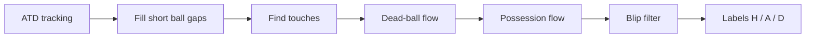
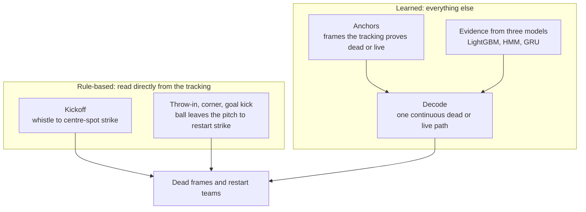
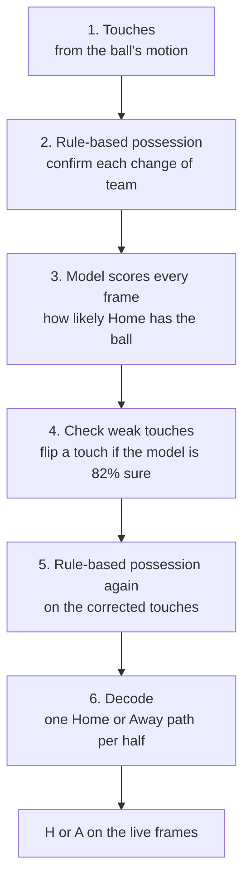

# Possession and dead-ball labelling from tracking data

Technical document. Terms written like [this](GLOSSARY.md) are explained in the [glossary](GLOSSARY.md).

## Abstract

We label every one of the 199,319 frames of a football match (25 frames per second) as Home possession, Away
possession, or dead ball. The input is the tracking data ([ATD](GLOSSARY.md#atd): the ball and the 22 players)
and, for set pieces only, the type of the event named in the [Smart Tagging](GLOSSARY.md#smart-tagging) file. We
use no external data.

The method has two connected flows, one for dead ball and one for possession, and each flow has a rule-based part
and a learned part. The rule-based parts work directly on the tracking: a touch is a break in the ball's motion,
possession changes only when an opponent's touch is confirmed as controlled, and a set piece starts when the ball
crosses a line and ends when a still ball is struck at the right spot. The learned parts handle what the rules
cannot see: stoppages with no ball exit (fouls, offsides, injuries) and touches that are weak or contested. They
use small models ([LightGBM](GLOSSARY.md#lightgbm), a two-state [HMM](GLOSSARY.md#hmm) and a small
[GRU](GLOSSARY.md#gru)) that read how the players move over seconds. They are trained only on
[labels the tracking itself proves](GLOSSARY.md#clean-labels), and then trained again on their own confident
frames ([self-training](GLOSSARY.md#self-training)). A [decode](GLOSSARY.md#decode) that pays a cost for every
change keeps stoppages in one piece and keeps the number of possessions in line with the touches. A short final
step, the [blip filter](GLOSSARY.md#blip-filter), removes tiny live stretches between dead spells.

On the public 5-minute window the final system reaches spell F1 0.750, macro F1 0.917, team accuracy 0.968 and
dead-ball F1 0.870. The touch rules alone, with the learned stoppage detector, reach 0.606, 0.871, 0.888 and
0.868. The main limitations are short flicker on contested balls, training on a single match, and no model of
events such as celebrations or video-review breaks. Training on several matches and adding more triggers are the
most direct next steps.

## Contents

1. [Introduction and data](#1-introduction-and-data)
2. [Approach](#2-approach)
3. [Training](#3-training)
4. [Possession rules](#4-possession-rules)
5. [Results](#5-results)
6. [Limitations](#6-limitations)
7. [Future work](#7-future-work)
8. [Reproduction](#8-reproduction)
9. [References](#9-references)

## 1. Introduction and data

**Task.** One label per frame: **H** or **A** (the team with the ball), **D** (dead ball) or **X** (not graded).
See [H, A, D, X](GLOSSARY.md#h-a-d-x).

**What we use.** The data bundle is described in [DATA.md](DATA.md).
- **Tracking ([ATD](GLOSSARY.md#atd)).** The ball and player positions and speeds for the whole match
  ([DATA.md](DATA.md#automatic-tracking-data-atd)). Every rule and every model is built from it. It is also the
  only source of training labels, and those are made by algorithms from the tracking itself (section 3).
- **[Smart Tagging](GLOSSARY.md#smart-tagging).** Used only as a label that says which set piece happened
  (throw-in, corner, goal kick, kickoff) ([DATA.md](DATA.md#smart-tagging)). Its start and end times and its team
  field are never read. Every boundary comes from the tracking.

**What we do not use.** No external data of any kind: no other matches, no outside tracking sets, no outside
labels and no pretrained models. Freely available tracking data of other matches exists, but we did not use it, and
we report the system without it. The broadcast recording, the video and the homography file are not used by the
pipeline.

### 1.1 Why learn at all: the intuition

The rules are exact when they can see. A touch is a break in the ball's motion, an exit is the ball over a line, a
restart is a still ball struck at the right spot. The problem is that the tracking often cannot see the ball: it is
missing on about 43% of frames (a pass in the air, a crowded box, occlusion). A foul or an offside may also leave
no ball signal at all. So rules alone cannot label the whole match.

What is left is that **the players move in recognisable ways around what the ball is doing.**
- In a stoppage, all 22 slow to a walk together, stand, and then speed up at the restart. In live play somebody is
  always running.
- In possession, the team with the ball stretches and pushes forward while the other team compacts and drops back,
  and the shape of both teams changes when possession changes.

These patterns can be written down as numbers (collective speed, sprints, players standing, spread, pressing,
crowding, how long the players have been still, over seconds of past and future) and a model can learn them. The
learned parts therefore use **the players' movement**, which is tracked on every frame, to fill the frames where the
ball is lost and to correct touches the rules are unsure about.

**Where the ball still matters.** The two flows use it differently:
- **Dead ball: the players' movement was enough.** We also tried a model that estimates where the ball is from the
  players alone (it halves the error of the obvious guess, the centre of the players) and gave its output to the
  dead-ball detector as extra input. It did not improve the detector, so the dead-ball models use player movement
  only. The ball is used by the rules (exits, strikes, a resting ball) and to make the training labels.
- **Possession: the ball is essential.** Who has the ball is decided by who touched it, so the touch rules are the
  primary source, and the labels the possession models learn from are built from clear touches. The models learn what
  possession looks like in player movement from those ball-based labels, and then use it to correct weak touches and
  to fill the frames between touches. The possession models do not take a ball column as input.

In short: **player movement carries the live/dead signal and the ball carries the possession signal.** The design is
a rule-based backbone built from the ball, with learned player-movement models correcting and filling it.

## 2. Approach

### 2.1 The idea in one page

Two flows work together:
- **Dead-ball flow:** which frames are dead, and which team restarts play.
- **Possession flow:** on the live frames, which team has the ball.

Each flow has a **rule-based part** and a **learned part**.
- The rule-based part works directly on the tracking. It is exact where the tracking is clear, and it is trusted first.
- The learned part is added where the rules cannot decide. It reads how the players move and fills or corrects the
  doubt.

The learned parts never replace the rules. They correct a rule where it is weak, or fill frames the rules leave open.
Each learned part also has a [guard](GLOSSARY.md#guard): it checks itself against this match's own labels and falls
back to the rule-based logic if a check fails.

The possession flow reads the dead frames and the restart teams from the dead-ball flow, so it runs second. The
blip filter reads the touches and the ball path as well.

### 2.2 Preparing the tracking: ball gaps and touches

Both flows start from the same two steps (`gap_fill.py`, `touch_detector.py`).

1. **Put the tracking in metres.** The ATD is turned into arrays in metres on a 105.3 x 68 m pitch. For the models,
   the second half is turned around so that both halves have each team attacking the same way.
2. **Fill short ball gaps.** The ball is missing on about 43% of frames. A gap shorter than 1 s is filled with a
   straight line between the last and the next seen position, never across half-time. Longer gaps stay missing,
   because a straight line is not a safe guess for a ball that has vanished for seconds.
3. **Find the touches.** A [touch](GLOSSARY.md#touch) is a moment where the ball's own motion breaks. Between touches
   the ball is a free body: it moves in a nearly straight line and slows smoothly. At each frame we compare its
   direction and speed over the 0.16 s before with the 0.16 s after. A big change marks a candidate touch, and
   candidates closer than 0.2 s are merged. The [toucher](GLOSSARY.md#toucher-and-credited-touch) is the nearest
   player to the ball, if within 3.5 m. This gives a short list of a few hundred touches, and everything after
   reasons about touches, not about each of the 199,319 frames.

The ideas behind the touch detection and the stoppage triggers are in the references in section 9 ([1], [2], [3]).

### 2.3 Dead-ball flow

Inside a set-piece stretch the rule-based result always wins. The learned part only fills the rest.

**Rule-based part** (`dead_ball.py`, `restart_triggers.py`, `kickoff_detector.py`)

- **Not in play.** Frames outside the halves, and the second half before its kickoff, are dead by the match clock.
- **Kickoff.** Dead from the whistle, which is where the players start slowing together before the strike, until the
  strike on the centre spot. The nearest player to the ball takes it.
- **Set pieces where the ball leaves the pitch** (throw-in, corner, goal kick).
  - *Start:* the [exit trigger](GLOSSARY.md#exit-trigger). The side line means a throw-in, the goal line means a
    corner or a goal kick. A Smart Tag of that type must confirm it, which is how an exit that is only tracking
    noise is rejected.
  - *End:* the [restart strike](GLOSSARY.md#restart-strike). The ball sits still at the spot the laws require (side
    line, corner arc, goal area), is struck, and then travels at least 5 m and stays on the pitch. A ball tossed to
    the taker, or a dummy run, fails this check and the search moves on. With no strike seen, the
    [calm run](GLOSSARY.md#calm-run) that covers the exit ends it, at its last touch in the final seconds.
  - *[Restart team](GLOSSARY.md#restart-team):* the player at the ball at the strike, otherwise the team that did
    not touch the ball last before the exit.
- **Early restart.** If the learned path stays dead for 5 s or more right after a restart the rules chose, the
  players had not resumed. The segment is extended to the end of that stretch and the restart moves with it.
- **Fallback (calm run).** If the learned detector is unavailable or fails its guard, a rule finds the other
  stoppages: the players' median speed stays low together for a minimum time, dead starts where the players began
  slowing, and it ends at the last touch in the final 5 s of the run. Both numbers (the speed and the time) are
  learned for the match from where calm runs end at the kickoff and at set-piece strikes.

**Learned part** (`dead_ball_ml.py`, `dead_ball_features.py`, `seq_net.py`)

It handles every dead stretch that is not a kickoff or a set-piece segment: fouls, free kicks, offsides, penalties,
injuries. These have no ball exit, so the rules cannot see them. What every stoppage does have is the players
slowing and standing together.

1. **[Anchors](GLOSSARY.md#anchors).** Frames the ball track and the touches prove.

   | Anchor | Rule |
   |---|---|
   | Dead: exit | the ball seen past a line on a tag-confirmed set piece |
   | Dead: wait | from that exit to the confirmed restart strike |
   | Dead: kickoff | the 3 s before a kickoff strike |
   | Dead: resting ball | the ball within 0.7 m of one spot for 3 s, outside the penalty areas |
   | Live: played | 4 s with the ball tracked on 90%+ of frames, staying 1 m inside the pitch, 10 m or more of travel and at least 2 touches |

   About 4% of the in-play frames are dead anchors and 36% are live anchors. The rest are decided by the evidence.
2. **Player features.** For every frame, from player positions and speeds only: team shape, speeds, sprints, how
   many players stand still, pressing, crowding, braking, and the same numbers averaged over windows from 0.5 s to
   8 s into the past and the future, plus how long the players have been still
   ([window features](GLOSSARY.md#window-features)).
3. **Evidence.** Three models score every frame that is not an anchor. Their [log-odds](GLOSSARY.md#log-odds) are
   averaged.
   - **[LightGBM](GLOSSARY.md#lightgbm)** on 150 player features, trained on the anchors only.
   - **[HMM](GLOSSARY.md#hmm).** Unsupervised, two states ("stopped" and "moving") on 23 movement features at 5
     frames per second. The "stopped" state is the one with the lowest mean player speed, fixed in advance. It uses
     no labels at all.
   - **[GRU](GLOSSARY.md#gru).** A small network (13.6 thousand weights) that reads 48 s windows of the same movement
     features, trained on the anchors only.
4. **[Decode](GLOSSARY.md#decode).** One best dead/live path per half. Each change of state costs the equivalent of
   about 2.4 s of firm evidence. Dead spells under 5 s are dropped and live gaps under 2 s are closed. This keeps a
   stoppage in one piece.
5. **Restart team.** The last credited touch in the final 5 s of the stretch, if there is one.
6. **[Guard](GLOSSARY.md#guard).** Before using the output, the detector checks itself against this match's own
   anchors. It falls back to the calm-run rule if there are too few anchors (under 1,500 dead or 5,000 live
   frames), if any model's [ROC AUC](GLOSSARY.md#roc-auc) on the anchors is low (LightGBM under 0.85, HMM under
   0.75, GRU under 0.80), or if the share of in-play frames called dead is outside 20% to 60%.

### 2.4 Possession flow

**Rule-based part** (`touch_detector.py`, `control.py`, `assemble.py`; details in section 4)

- Possession is one pointer ("which team has it") that only moves when an opponent's touch is confirmed as
  controlled. A stray touch, a duel or a deflection leaves it where it was.
- After a stoppage the restart team sets the pointer. Dead frames are always D.
- Frames take the team of the pointer, so labels change only at controlled events.

**Learned part** (`possession_ml.py`, `seq_net.py`)

The rules stay primary. The model only corrects weak touches and fills the doubt.

1. **[Clean labels](GLOSSARY.md#clean-labels).** A frame gets a team only when the tracking makes it clear: near a
   [clear touch](GLOSSARY.md#clear-touch-and-weak-touch) (within 1.5 m of the ball and no opponent within 3 m),
   between two clear touches of the same team (at most 6 s apart, same half, no dead frame between), and 0.5 s
   either side of a clear touch. Contested touches, the flight between touches of opposite teams, and dead frames
   stay unlabelled. About 21% of live frames get a label.
2. **Model.** A [LightGBM](GLOSSARY.md#lightgbm) and a [GRU](GLOSSARY.md#gru) each give the probability that Home
   has the ball on every frame, and their log-odds are averaged. They read team-shape features only: where each team
   stands and moves, the difference between the teams, and the main numbers over the past 2 s, the next 2 s and a
   centred 6 s. No ball column is an input.
3. **[Touch fix](GLOSSARY.md#touch-fix).** A weak touch is flipped to the other team when the model, averaged over 2
   s around the touch, is at least 82% sure of that team. Step 2 of the rules then runs again on the corrected
   touches.
4. **[Decode](GLOSSARY.md#decode).** The corrected rule labels vote for their team (a vote of 2 in log-odds), the
   model adds its own evidence, and one best Home/Away path per half pays a cost for each change. The cost is
   searched so that the path makes as many changes as the touches confirm (a change that the same team's next
   credited touch repeats, with no dead stretch between). That keeps the number of possessions in line with the
   tracking and stops the label flickering with the model. Possessions under 1 s take the previous team. Dead frames
   stay D.
5. **[Guard](GLOSSARY.md#guard).** The model is used only if at least 3,000 frames have clean labels and its ROC AUC
   on them is at least 0.80. Otherwise the rule-based possession is kept.

### 2.5 Blip filter (final step)

The last step only moves frames from live to dead. A live stretch shorter than 5 s that sits between two dead spells
becomes dead, unless play is visible inside it: two or more credited touches, or at least 10 m of ball travel. It
fills 12 such blips (888 frames) in this match.

### 2.6 How the models are trained

Section 3 describes the training: window features, clean labels, self-training and cross-fitting.

### 2.7 Why this design

- **Rules first, models where rules are blind.** Touches, exits and strikes are things the tracking shows directly,
  so they are exact when seen. Fouls and offsides leave no ball signal, and a touch is sometimes ambiguous. Those are
  the two places a model helps.
- **Algorithm-made labels only.** The anchors and clean labels are frames the tracking proves, so the models learn
  from the match itself and need no outside data.
- **A decode instead of frame-by-frame calls.** Both flows end in a search for the best whole path that pays for
  every change. A stoppage stays one block, and possession changes only about as often as the touches confirm.
- **Fallbacks.** If a model is missing or a guard fails, the rule-based logic runs, so the output never depends on a
  model that looks wrong.

## 3. Training

Every label the models train on is made by an algorithm from the tracking of this match. No person labelled a frame.
A model's score is always measured against these algorithm-made labels, never against a reference.

### 3.1 Why windows, and not single frames

Football tracking is a sequence. A single frame says very little: a stoppage shows up as the players slowing
together over seconds, and possession shows up in how both teams move around a touch. So every model reads a
window.

- **[Window features](GLOSSARY.md#window-features).** Dead ball: the same player numbers (team shape, speeds,
  sprints, players standing, pressing, crowding, braking) averaged over windows from 0.5 s to 8 s into the past and
  the future, plus how long the players have been still and how long since or until a sprint. Possession: where each
  team stands and moves, the difference between the teams, and the main numbers over the past 2 s, the next 2 s and a
  centred 6 s, with the change between past and next.
- **A sequence model.** The [GRU](GLOSSARY.md#gru) reads a 48 s window at 5 steps per second, so it sees the whole
  context around a frame. Scores from overlapping windows are averaged with triangular weights.
- **Players, not the ball.** The learned models read player movement, not a ball column. The ball is used by the
  rules (touches, exits, strikes) and to make the clean labels, so the models are an independent second opinion
  from the players (see section 1.1).

### 3.2 Clean labels

We do not label every frame. We label only the frames the tracking itself proves and leave the rest unlabelled.

| Model | A frame is labelled when | Labelled share |
|---|---|---|
| Dead ball | it is a dead [anchor](GLOSSARY.md#anchors) (a confirmed exit, the wait to the restart strike, the 3 s before a kickoff strike, a ball resting 3 s outside the penalty areas) or a live anchor (4 s of a ball tracked on 90%+ of frames, staying 1 m inside the pitch, travelling 10 m or more with at least 2 touches) | about 4% dead, 36% live |
| Possession | it is near a [clear touch](GLOSSARY.md#clear-touch-and-weak-touch), or between two clear touches of the same team (at most 6 s apart, same half, no dead frame between) | about 21% of live frames |

Contested touches, the flight between touches of opposite teams and dead frames stay unlabelled. Training on a smaller
set of reliable labels, and letting the models extend to the rest, keeps the labels from teaching the models the rules'
own mistakes.

### 3.3 Self-training on confident frames

After the first round, the whole flow (decode included) runs with the round-1 models. Frames where the result is
confident and agrees with the rules join the training set, and the model is trained again
([self-training](GLOSSARY.md#self-training)).

- **Dead ball:** frames where the decoded path agrees with both models, each at least 70% (dead) or 60% (live) sure.
  This adds about 35,000 dead and 29,000 live frames to the 6,000 and 56,000 anchors.
- **Possession:** frames where the decoded path agrees with the corrected rule labels and the probability is at
  least 70%. This adds about 47,000 frames to the 19,000 clean ones.

Self-training lets the models learn the contested stretches next to the proven ones, without using any label that
did not come from the tracking.

### 3.4 Avoiding leakage: cross-fitting

Neighbouring frames are almost identical, so a random split would let a model see the frame next to its test frame.
Instead we cut the match into 2-minute blocks, hold out a fifth of the blocks at a time, and also drop 10 s on each
side of the held-out blocks from the training set
([cross-fitting](GLOSSARY.md#cross-fitting-and-out-of-fold-scores)). Every frame of the training match is scored by
a model that never saw its block. These are the out-of-fold scores, and the pipeline uses them for this match. A
final model fitted on all blocks is stored for any other match.

### 3.5 How features and hyperparameters were chosen

- **Small, regularised models, fixed in advance.** We chose small models up front and did not search large grids.
  The LightGBMs use shallow trees (15 leaves), a low learning rate (0.05), column and row subsampling (0.5 and 0.8),
  a minimum of 40 samples per leaf and L2 regularisation. The GRU has about 14,000 to 16,000 weights, with dropout,
  weight decay, input noise, gradient clipping, a validation block for early stopping and learning-rate drops, and
  three seeds averaged.
- **Features by meaning, not by search.** The feature groups follow what a stoppage or a possession change looks like
  in player movement (everyone slowing, a team compact and pushing, sprints). The dead-ball LightGBM takes 150
  features and the possession LightGBM 100.
- **Choices used only algorithm-made labels.** Choices were judged by the out-of-fold [ROC AUC](GLOSSARY.md#roc-auc)
  on the clean labels, not against any reference data. The guards in section 2 use the same numbers.
- **Fixed seeds.** Every seed is fixed, so training again gives the same models.

### 3.6 What worked and what did not

Worked, in the order we found them:
1. **A learned stoppage detector** next to the calm-run rule. Anchors plus a LightGBM and an HMM, with a decode that
   keeps dead in one piece, found the stoppages the rules could not see.
2. **A touch fix with a learned model.** Flipping weak touches the model is at least 82% sure about, then running the
   rules again. The touch rules stay primary and the model only corrects them.
3. **Clean labels** for possession. They removed the noise that made an earlier model decide on its own and produce
   too many possessions.
4. **A decode with a change budget.** Searching the cost per change so that the path makes as many changes as the
   touches confirm kept the number of possessions realistic.
5. **Self-training and a GRU in both parts.** The second model gives a different view (a sequence) and
   self-training widens the labelled set. This was the largest single gain.
6. **A blip filter** after the main flow.

Tried and not adopted:
- Making the touches the only input to the decode, and snapping the decode to touch times.
- Refining the exact start of a possession change.
- Smaller models to reduce overfitting.
- A prior on how long a possession lasts.
- A joint decode of dead, Home and Away in one path.
- A ball-position estimator learned from player movement (it halves the error of the centre-of-players guess), used as
  extra input for the dead-ball detector. It gave no gain, which is why the dead-ball models use player movement only
  (section 1.1).
- A 1D CNN as a second sequence model next to the GRU. It moved dead ball and possession a little in opposite
  directions, so we kept the GRU alone.
- A 2 s restart confirmation in the final step. It extended nothing and was removed.

## 4. Possession rules

These are the rules that decide who has the ball (`touch_detector.py`, `control.py`, `assemble.py`). Their numbers were
set from the literature in section 9 and from experiments on the tracking, not picked at random.

### 4.1 Touches

- A touch is a break in the ball's own motion. The ball is a free body between touches: it moves in a nearly straight
  line and slows smoothly. At each frame we compare the direction and speed over the 0.16 s before with those over
  the 0.16 s after. The score is the change of direction in degrees plus 15 times the change of speed in m/s, and 35
  or more makes a candidate. Candidates closer than 0.2 s merge into the strongest.
- The ball must be trustworthy for the whole window (seen, or filled over a gap under 1 s).
- **The toucher** is the nearest player to the ball at that instant, but only within 3.5 m. Beyond that nobody is
  called the toucher and the event is kept with no team. A touch with no team never changes possession.

### 4.2 Loose balls and challenges

Not every touch by the other team is a change of possession. An opponent's touch moves possession only if it is
confirmed as control ([chain, carry, deflection](GLOSSARY.md#chain-carry-deflection)):
- **Chain.** Within 2 s the same player touches the ball again, or the ball goes to a teammate of that player.
  Another teammate who is merely near the ball does not confirm it.
- **Carry.** No other touch follows in a 0.4 s window and the same player stays with the ball: within 3.5 m of it for
  at least 70% of that window, and the ball's path is no more than 4 m longer than his own (a player standing under a
  ball in the air does not count).
- **Deflection.** If the original team touches the ball again before the opponent does anything more with it, the
  change is cancelled.
- **Duels and 50/50 balls.** With no chain and no carry, the touch is treated as a stray, a duel or a kick, and
  possession stays with the original team. The kicker is ignored, and the next touch can take the ball.
- **Where the change starts.** A confirmed change starts at the opponent's own touch frame, not at the later frame
  when the evidence became clear.
- **Gaps in the ball.** The ball is missing on about 43% of frames. Gaps under 1 s are filled with a straight line,
  and longer gaps are left missing. A touch is never judged over a stretch where the ball cannot be trusted.

### 4.3 Restarts

- After a stoppage the [restart team](GLOSSARY.md#restart-team) comes from the dead-ball flow: the player nearest the
  ball at the strike for a set piece or a kickoff, or the last credited touch in the final 5 s of a learned stoppage.
- For a throw-in, corner or goal kick with nobody near the ball, the team that did not touch it last before the exit
  takes it, as the laws say.
- A restart's team overrides what the touch rules would say at that frame, because a restart has a clear possessor.
- When the restart team is unknown, possession is cleared and the first touch afterwards opens it.

### 4.4 Dead frames and the kickoff

- Dead frames are always D, whatever the touch rules say.
- Frames before the first kickoff (warm-up) have no evidence and stay X.
- A kickoff is taken by the player nearest the centre spot, and that team has the ball from the kick.

### 4.5 Learned correction

The learned part of the possession flow (section 2.4) then corrects weak touches the model contradicts with at least
82% confidence, runs these rules again, and decodes the frames in between. The rules above stay the primary source.

## 5. Results

We report only the public 5-minute window, the one reference we use. The numbers are for reporting. No model,
threshold or constant was chosen from them. See [EVALUATION.md](EVALUATION.md) for the definitions of the scores.

| Stage | Spell F1 | Macro F1 | Team accuracy | Dead-ball F1 | Possessions (reference 17) |
|---|---|---|---|---|---|
| Touch rules with the learned stoppage detector | 0.606 | 0.871 | 0.888 | 0.868 | 16 |
| + touch fix and learned possession (LightGBM) | 0.640 | 0.893 | 0.930 | 0.868 | 13 |
| + self-training and a GRU in both parts | 0.750 | 0.917 | 0.968 | 0.870 | 15 |
| + blip filter (final) | 0.750 | 0.917 | 0.968 | 0.870 | 15 |

- The learned possession part mainly lifts team accuracy and macro F1.
- Self-training with the GRU gives the largest step in spell F1.
- The 5-minute window has no short live blips, so the blip filter leaves it unchanged. On the whole match the filter
  fills 12 blips (888 frames).
- Reproducibility: retraining the models from scratch with the pinned requirements gives the same models and the same
  submission file (section 8).

## 6. Limitations

- **Flicker on contested balls.** When the ball is loose or two teams are close, the label can flip for a short time.
  The blip filter removes live stretches under 5 s between dead spells, and the 1 s merge removes very short
  possessions. Short flicker between Home and Away inside a live stretch, and dead spells that start or end a little
  early or late, still remain.
- **Noisy ball tracking.** The ball is unseen on about 43% of frames. Short gaps are filled, but long gaps leave the
  touch rules blind and the learned part has to fill them from the players alone.
- **One match for training.** All models are trained on this match, with out-of-fold scores to avoid leakage. On
  another match the stored models apply as they are, but they have seen one team's style and one tracking setup.
  Without outside tracking data we could not train more broadly.
- **Weak touches.** A touch by a player far from the ball, or with an opponent close, is uncertain. The model corrects
  it only at 82% confidence, so some wrong touches pass through.
- **Restart team.** For stoppages with no clear last touch the restart team is unknown. The first touch decides it,
  which can be wrong for a few seconds.
- **Events that are not modelled.** Celebrations, video-review breaks, injuries without a clear slowdown and
  substitutions are handled only through the player-movement signals.

## 7. Future work

- **Train on several matches.** More than one match, including freely available outside tracking data, would give the
  learned parts more variety in style, tracking quality and stoppage types, and would reduce overfitting to one match.
- **More triggers.** Rules for events that are now left to the learned detector: goal celebrations, video-review
  breaks, substitutions, injuries and cooling breaks, penalties and their set-up.
- **A learned touch scorer.** Replace the fixed touch score and the 1.5 m radius with a model trained on the clear
  touches.
- **A model that also reads the ball.** A sequence model on the ball path plus the nearest players would be a third,
  independent view.
- **Better joint decoding.** One decode that carries the restart team through a stoppage as part of its state, instead
  of handing it over between the two flows through restart markers.
- **Per-situation settings.** Let the touch-fix confidence and the cost per change depend on the situation, chosen by
  cross-validation on algorithm-made labels.

## 8. Reproduction

See [REPRODUCTION.md](REPRODUCTION.md).

1. Install `requirements-solution.txt`.
2. Put the data bundle in `data/` so that `data/tactical/` exists, or set `MTAH_DATA_DIR` to the folder that contains
   `tactical/` (see [DATA.md](DATA.md)).
3. Run `python solution/run_pipeline.py --out TikiTech.csv`, then `python evaluation/validate_submission.py
   TikiTech.csv`.

To rebuild the models from scratch, install `requirements-train.txt` and run `solution/train_dead_ball_ml.py` and then
`solution/train_possession_ml.py`. The training seeds are fixed. Retraining reproduced the stored models (a
floating-point difference of about 1e-11 in one HMM file) and a byte-identical submission file. The training scripts
overwrite `solution/models/` and clear the evidence caches in `solution/cache/`.

## 9. References

[1] Comonitski, J. *Generating footballing event data from match tracking data.* Medium.
https://medium.com/@johncomonitski/generating-footballing-event-data-from-match-tracking-data-1730c58ad598

[2] arXiv:2202.00804. https://arxiv.org/pdf/2202.00804

[3] Montoliu, R., Martín-Félez, R., Torres-Sospedra, J. and Martínez-Usó, A. Team activity recognition in association
football using a bag-of-words-based method. *Human Movement Science*, 41:165–178, 2015.
